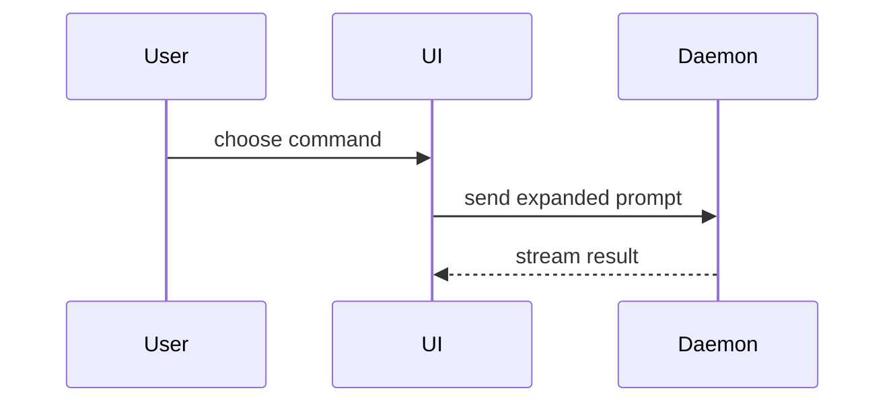

# Merge requests

An MR or PR targets the base and carries one branch's feature ([BRANCHES.md](BRANCHES.md)).

## Before pushing

Rebase onto the latest base, so the checks run against what the MR merges into, then run the checks of every app the branch touched; the project's docs name them. A branch already on origin goes up with `--force-with-lease`.

```sh
git fetch origin <base> && git rebase origin/<base>
```

## Description

Adapted from [mattpocock/skills `pr`](https://github.com/mattpocock/skills/blob/main/skills/engineering/pr/SKILL.md) (MIT); its Summary visuals come from Dex Horthy's [HumanLayer `show-me`](https://github.com/humanlayer/skills/blob/main/plugins/show-me/skills/show-me/SKILL.md) (MIT). See [CREDITS.md](CREDITS.md).

Use this template for the MR body:

```markdown
## Summary

<diagram, diff-sketch, or tree>

## Evidence

- **Before:** <screenshot/output/failing test run>
  **After:** <screenshot/output/passing test run>

## Merge Danger

**Door:** <one-way or two-way>

<optional: description>

**Blast Radius:** <one-word description>

<optional: potential ramifications of merge>
```

Skip all preambles and keep prose brief. Use the domain language of the project's `GLOSSARY.md`, where it has one. The issue number (`#90`) goes in the Summary's text. The description reads as the author's own and names no tool or model that wrote it.

### Summary

Pick the smallest view that makes the key point clear.

- Show logic or an algorithm as pseudocode:

```text
on(save)
  if content is unchanged
    return cached result
  write new content
  return fresh result
```

- Show runtime control flow as a call tree:

```text
submitForm
  createSession
    persistPrompt
    launchAgent
  navigateToSession
```

- Show UI structure as a component tree, including state and module boundaries that matter:

```text
<SessionPage> (apps/example/src/routes/session.tsx)
  useSessionEvents()
  <SessionToolbar>
    <RunSkillButton> (packages/ui)
```

- Show file responsibility or a broad refactor as a shallow file tree:

```text
src/
├── commands/       # parses user actions
├── sessions/       # owns session state
└── transport/      # sends API requests
```

- Show component interaction, control flow, or data flow with Mermaid:



- Use `diff` when the point is what changes and the surrounding shape already exists. Match the diff shape to the topic.

For a component change:

```diff
 <SessionPage>
   useSessionEvents()
   <SessionToolbar>
+    <RunSkillButton />
   <SessionTimeline>
+    <SkillResultCard />
```

For a file-layout change:

```diff
 src/
 ├── commands/
+│   └── show-me.ts       # expands the slash command
 ├── sessions/
-└── transport.ts
+└── transport/
+    ├── client.ts
+    └── stream.ts
```

For a call-tree or call-stack change:

```diff
 submitForm
   createSession
     persistPrompt
+    expandSkillMention
     launchAgent
-  navigateToSession
+  navigateToSession
+    subscribeToEvents
```

For a state or control-flow change:

```diff
 on(save)
-  write content
+  if content is unchanged
+    return cached result
+  write new content
+  invalidate cache
```

- Show the whole block when most of it is new, when omitted context would hide ownership or order, or when the reviewer needs a copyable target shape:

```ts
function expandSkill(command: string): string {
  const skillName = command.slice(1);
  return `use the ${skillName} skill`;
}
```

Place each visual next to the short text it supports. Keep only the calls, files, props, states, and boundaries the reviewer needs to see what the change does.

One visual may be enough, several may be needed; all of them rarely are. Use your judgement and don't overwhelm the reviewer.

### Evidence

Concrete evidence that the change works. Show a before and after.

Screenshots are S-tier when the change is visual; take and mark them as [Screenshots](#screenshots) says.

Execution-based evidence is A-tier: test results, console output. Show the exact test that now fails and passes, using pseudocode.

Gather it before writing the body:

1. Pick the test that pins the change: one the branch adds or changes, or a new one.
2. Run it against the base, from a worktree or a server on `origin/<base>`. Its failure is the Before.
3. Run it on the branch. Its pass is the After.

A visual change shows its screenshots instead. A change no test or screen can show, such as docs or config, shows the output that differs between the base and the branch.

### Merge Danger

Describe whether it's a one-way or two-way door. You can walk back through two-way doors, but not one-way doors. An MR that is cheap to roll back is lower risk. Changes that involve destructive actions or hard-to-reverse decisions are one-way doors.

The blast radius is the potential impact or scope of the changes introduced by this MR. Consider all possibilities. Examples are layout shift, breakages for consumers, mobile responsiveness, etc.

## Screenshots

Work touching a frontend carries screenshots in its Evidence: the real app running locally with seeded data, not component mocks, each with its viewport named. The reviewer sees the change before merging; a diff is not a look at the thing. The same shots later go in the issue's How to test ([ISSUES.md](ISSUES.md)). Backend-only work skips them.

Every shot marks what changed, so the reviewer finds it at a glance instead of comparing two pictures:

- an outline on the changed element: dashed red on the before, solid in an accent colour on the after
- a label on the shot with the old or new value, for a change with no look of its own (an alt text, a heading's text or level)
- the shot cropped to the marks, with enough page around them to place them

Done when each mark sits on a change and every change the page shows has one.

## After the merge

[CLEANUP.md](CLEANUP.md).
